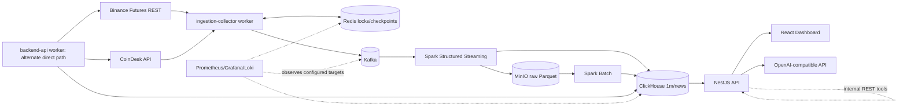

# System Architecture

Đường liền là data flow; đường chấm là control/observability. Collector tách nguồn khỏi compute và Kafka cho phép consumer phục hồi bằng offset/checkpoint. Đổi lại, hệ thống có nhiều điểm lưu trữ và semantics ít nhất một lần. Direct worker giảm số thành phần nhưng tạo kiến trúc cạnh tranh và ghi thẳng nến 5m. Lý do thiết kế này không được tài liệu/cấu hình thống nhất xác nhận (`INFERRED`).

Real-time/near-real-time: cron collector mỗi phút, Spark trigger 30 giây. Batch: ScheduledSparkApplication mỗi 5 phút. Storage: Kafka log, MinIO raw, ClickHouse analytical, Redis coordination. API/UI không có authentication (`VERIFIED_IN_CODE`).
