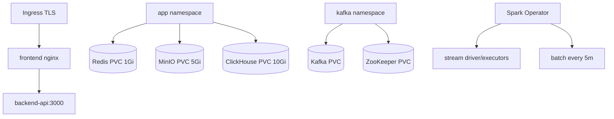

# Infrastructure & Deployment

Kubernetes hỗ trợ namespace `app`, `kafka`, `monitor`. Workloads: Redis/MinIO/ClickHouse/Kafka/ZooKeeper StatefulSet; collector/API/frontend Deployments; SparkApplication stream; ScheduledSparkApplication batch; monitoring stack. Local Docker Compose chỉ có trong collector (Redis+Kafka) và backend; không có compose thống nhất toàn hệ thống.

ConfigMaps `redis-env`, `minio-env`, `clickhouse-env`, `ingestion-collector-env`, `backend-api-env`, Spark env được tham chiếu nhưng phần lớn không định nghĩa trong repository (`UNKNOWN`). Không thấy Kubernetes Secrets chứa credentials; TLS Secret do cert-manager dự kiến tạo. Nhiều workload chỉ có requests, thiếu limits/probes; ClickHouse image `latest`; MinIO console và ClickHouse HTTP được ingress công khai. CI chỉ thấy reusable Docker build/push trong collector/stream; không có pipeline test/deploy toàn hệ thống.
