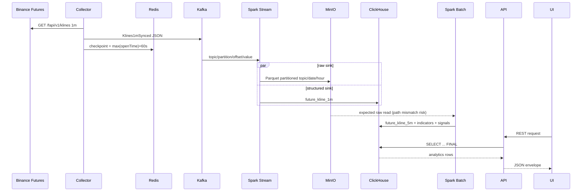

# End-to-End Data Flow

| Step | Code | Input → output | Timing/failure |
|---|---|---|---|
| Fetch | `worker.service.ts:168-224` | Binance array → KafkaKline1m | cron 1m; API errors become empty |
| State | `worker.service.ts:200-220` | max openTime → Redis checkpoint | after emit; Redis loss replays 60m |
| Kafka | `worker-kafka.service.ts:54-56` | JSON event → topic | no key; 3 partitions |
| Raw | `kafka_raw_to_minio.py:83-119` | Kafka record → Parquet | 30s/checkpoint |
| Structured | `kafka_to_clickhouse.py:168-198,289-311` | explode/cast → 1m table | duplicate possible on replay |
| Batch | `kline_batch_job.py:73-167` | raw 1m → 5m/indicators | every 5m; configured path suspect |
| Signals | `signal_batch_job.py:56-145` | last 2h → rules | rerun not idempotent |
| API/UI | `clickhouse-market-data.repository.ts:16-85`; `marketApi.ts:45-58` | query → chart candles | cache 60s configured |

News flow: CoinDesk API → collector `syncNews` → Kafka NewsSynced → Spark raw + `news` → news/news-impact API → News/News Impact pages. Alternate direct backend worker can bypass Kafka/MinIO but is not deployed in current manifests.
