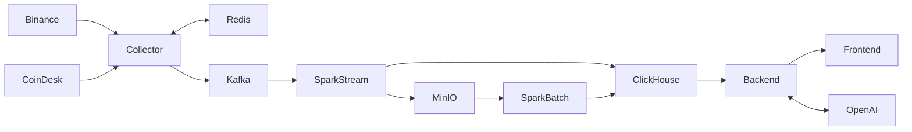

# Project Knowledge Pack — Crypto Analytics

## Purpose and verified scope

Hệ thống thu thập Binance crypto market data và CoinDesk news, xử lý streaming/batch, lưu analytical datasets, cung cấp dashboard và chatbot. Sáu project: `ingestion-collector`, `processing-stream`, `processing-batch`, `backend-api`, `frontend-dashboard`, `infra-k8s`. Mọi mô tả dưới đây là static code evidence; manifests chưa chứng minh runtime success.

## Architecture

Một alternate backend worker gọi Binance/CoinDesk và ghi ClickHouse trực tiếp. Nó tồn tại trong code nhưng không có workload K8s tương ứng. Vì vậy không được ghép hai đường ingestion thành một chuỗi duy nhất.

## Services and contracts

Collector worker cron mỗi phút. Binance Futures ticker endpoint `/fapi/v2/ticker/price`; kline endpoint `/fapi/v1/klines`, interval 1m, limit 95, concurrency 10. Redis keys: `binance_tickers`; `binance_klines_1m_checkpoint:<ticker>`; `coindesk_news_checkpoint`; `flag:<lock-name>`. News endpoint `/news/v1/article/list`, limit 100, 1-hour catch-up windows; source supplies sentiment.

Kafka topics use `<prefix>-ingestion-collector-*`; `klines-1m` and `news` carry actual events. Topic admin requests 3 partitions/RF1. Events are JSON-bigint, without message key. Kline event fields: type/ticker/interval/fromTime/toTime/nextCheckpoint/klines/syncedAt; each kline includes Binance 12-field payload. News event wraps normalized news items.

Spark 3.5.1 reads both topics from latest by default, `failOnDataLoss=false`. Raw Parquet columns preserve topic, partition, offset, timestamp, key, raw_value plus parsed metadata; partition layout is `topic=.../event_date=YYYY-MM-DD/event_hour=HH`. Independent checkpoint paths back raw and ClickHouse sinks. Structured rows go to `future_kline_1m` and `news`; null numeric fields are coalesced to zero.

Batch Spark 3.4.2 groups 1m rows by UTC epoch 5-minute bucket. Open=first, high=max, low=min, close=last, volume=sum. It does not demand five rows. It writes only three newest rows per ticker to `future_kline_5m` and `kline_indicators`. The input path appears inconsistent with streaming output. On read failure it fetches Binance Spot BTCUSDT, then static mock—highest-risk behavior in the project.

Indicators: SMA20/SMA50 include current candle and allow partial windows. RSI14 uses 14 initial deltas then Wilder smoothing, needs 15 prices, with at most 101 close values. Bollinger uses SMA20 ± 2 sample standard deviations in batch; higher-timeframe API uses population stddev. Volume spike is current volume > 3× average prior 7 candles. Pump/Dump compares current close with previous close: ≥+0.2% or ≤-0.2%, and current volume ≥1.2× average previous 5 candles. This is rules-based analytics, not ML.

ClickHouse tables: `news`, `future_kline_1m`, `future_kline_5m`, `kline_indicators`, `signals`; all ReplacingMergeTree with version except operational details as defined in DDL. No TTL/materialized view/migrations. News key `(publishedOn,id)`; klines/indicators `(ticker,openTime)`; signal order `(timestamp,ticker)`. `FINAL` is used by most API queries.

Backend API routes: `/api/kline/klines`, `/api/kline/time-now`, `/api/indicators`, `/api/news`, `/api/news/limit`, `/api/signals/active`, three overview routes, four news-impact routes and POST `/api/chatbot`. It aggregates from 5m candles; higher timeframe buckets must contain the expected number of 5m rows. Global response interceptor may envelope responses. Mock repositories are selected by `USE_MOCK`, whose code default is true.

News Impact floors publish time to a 5m bucket and treats that candle close as reference price. It looks up +5m/+15m/+1h/+4h bucket closes and computes percent change. Missing data is null. Correlation averages available impacts by source-provided sentiment over up to 100 recent news records. This is temporal association, not causal inference.

Frontend React routes: Overview, Chart, News, News Impact, Chatbot. It calls `/api`, supports explicit mock mode, normalizes mixed response shapes and displays localized loading/errors. Chart uses lightweight-charts. No automatic polling was found.

Chatbot uses OpenAI SDK with configurable model/base URL. Function calling maps tools to internal REST endpoints; tool calls can execute in parallel and payloads are capped. The model never queries ClickHouse directly. No RAG, embeddings, vector DB, trained ML, durable conversation history or tool authorization exists.

Kubernetes deploys single-replica Redis, MinIO, ClickHouse, Kafka/ZooKeeper; collector worker; stream SparkApplication; batch every 5 minutes; API; nginx frontend; Prometheus/Grafana/Loki/Promtail/exporters. Many env ConfigMaps are external/missing from repo. Secret values are intentionally absent. Deployment is `CONFIGURED_NOT_EXECUTED`.

## Main issues and limitations

1. Critical mock/Spot fallback can contaminate production analytics.
2. Stream output and batch input paths likely differ.
3. Collector may publish an open minute candle and then checkpoint it.
4. Redis lock release is not ownership-safe.
5. Sink and signal reruns are not strictly idempotent.
6. Dual ingestion paths create ambiguous data ownership.
7. No auth; storage ingress exposure and missing Secret workflow.
8. Single replicas/RF1 and incomplete resource/probe configuration.
9. Sparse tests; no verified end-to-end run or coverage.
10. No alert rules/data freshness checks; error fallbacks can mask outages.

## Configuration and operation

Core variables are documented in `18-CONFIGURATION-REFERENCE.md`. Safe startup dependency order is storage/brokers, collector/stream, batch/API, frontend, then monitoring verification. Never infer successful operation from manifests. Validate bucket creation, topic creation, ClickHouse tables, checkpoint writeability and API mock flags before trusting output.

## Testing status and open questions

Only scaffold backend tests were found; no business-flow tests. No suite was executed during this documentation-only analysis. Unknowns include actual production ConfigMaps, bucket bootstrap, canonical ingestion path, Kafka retention/acks, deployed backend worker, backups and out-of-repo dashboards. Use `20-SOURCE-EVIDENCE-INDEX.md` to locate proof and `19-OPEN-QUESTIONS.md` before making operational claims.
